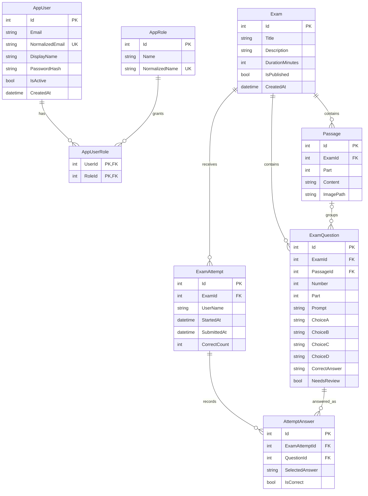

# TOEIC database schema

The backend uses SQL Server through Entity Framework Core. On its first launch, `EnsureCreated` creates the tables from the entity model. The connection string is in `Backend/appsettings.json` and can be overridden with `ConnectionStrings__ToeicDatabase`.

`AppRoles` is initialized with `Admin` and `User`. Public registration always assigns `User`; an Admin can change roles from `/AdminUsers`. To create the first Admin, set `Auth__BootstrapAdmin__Email` and `Auth__BootstrapAdmin__Password` in the environment before starting the backend. The seed runs only if that email does not already exist.

Part 5 questions have no passage. Part 6 and Part 7 questions may link to a shared passage, and Part 7 can represent a set of questions for a longer text. Answers and scoring are stored per attempt. The unique `(ExamId, Number)` index prevents duplicate question numbers in one exam.
